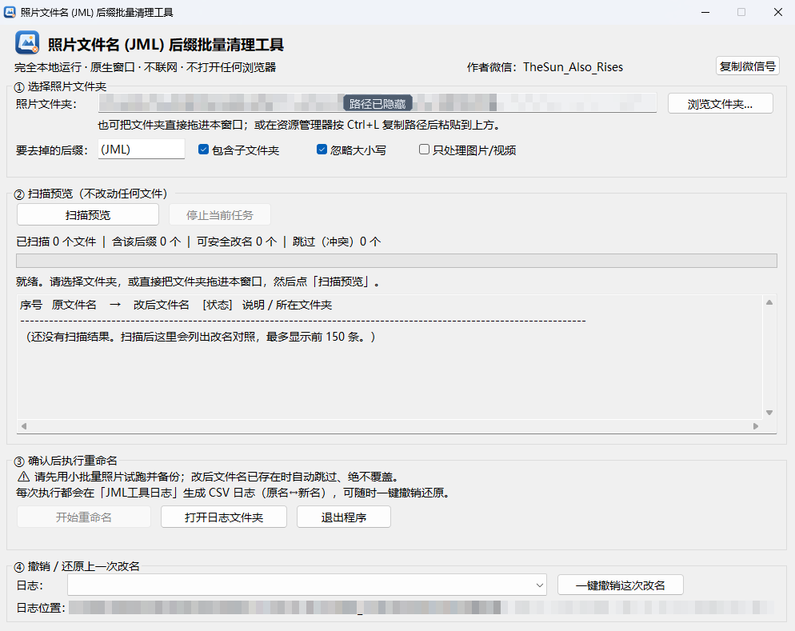
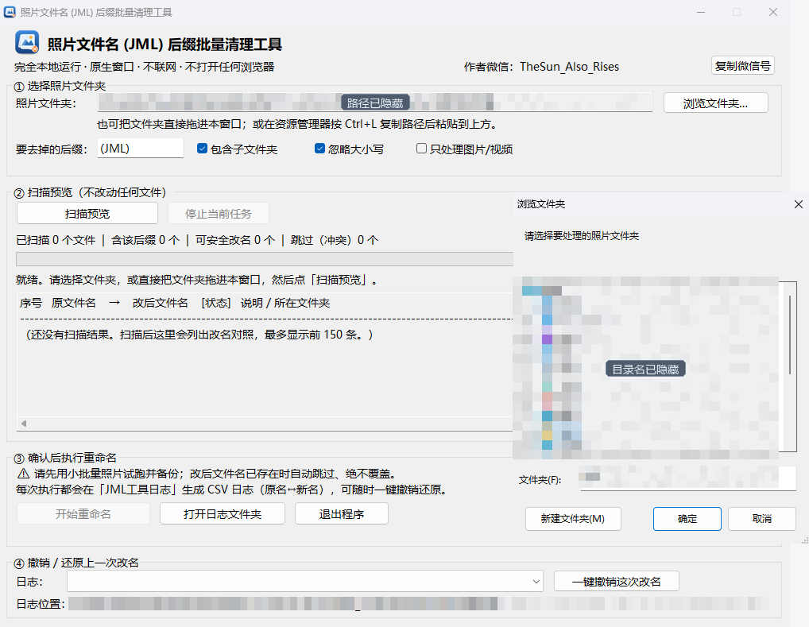
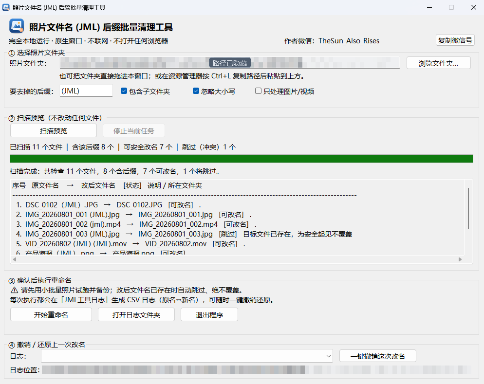
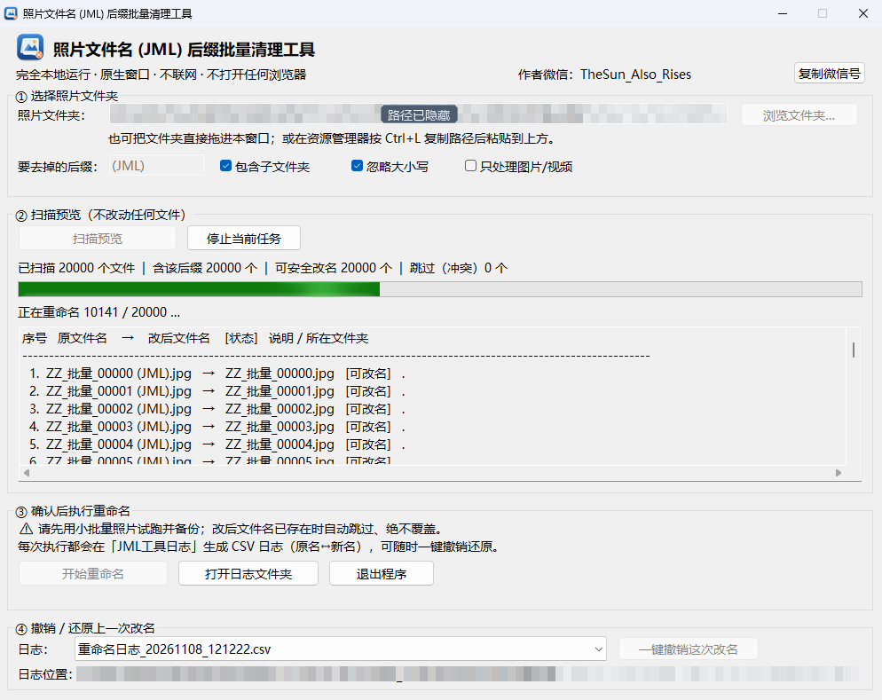
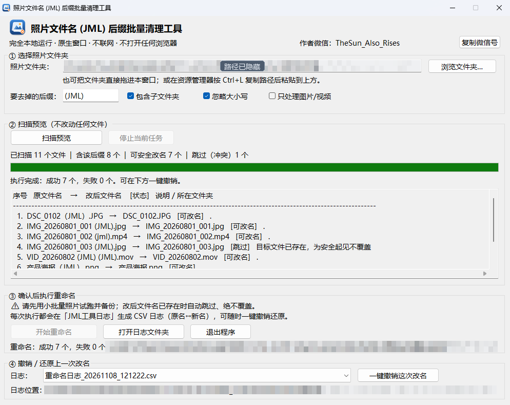
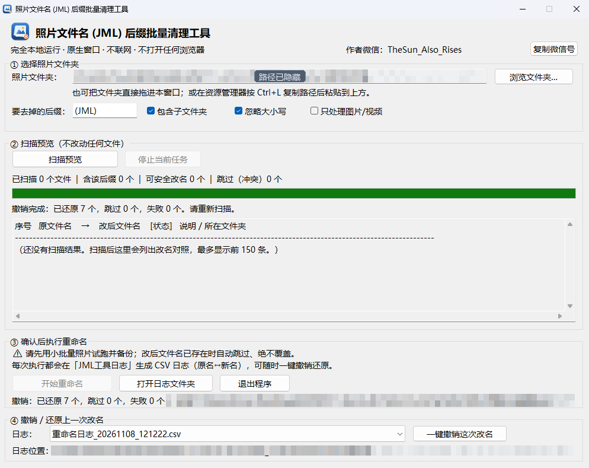

# JML-Renamer · 照片文件名 `(JML)` 后缀批量清理工具

完全本地运行的 Windows 小工具：批量遍历文件夹，自动去掉照片 / 视频文件名里的 `(JML)` 后缀；**不联网、不打开浏览器、不上传任何文件**，并自带扫描预览、冲突保护和一键撤销。

> 实际场景中，很多相机 / 网盘 / 同步工具会在导出照片或视频时，自动在文件名末尾追加一段类似 `(JML)` 的标识。这个工具就是用来把这段后缀干净地批量去掉。

---

## ✨ 功能特性

| 特性 | 说明 |
| --- | --- |
| 批量遍历 | 递归处理子文件夹，支持 5 万 + 文件 |
| 扫描预览（只读） | 改名前先预览「含后缀 / 可改名 / 冲突跳过」统计与对照表，**不改动任何文件** |
| 冲突保护 | 目标名已存在或多个文件改名后重名 → **自动跳过，绝不覆盖** |
| 一键撤销 | 每次执行生成 CSV 日志，可原样还原为原始文件名 |
| 完全本地 | 原生 Windows 窗口，不启动网页服务、不占用任何端口、不联网 |
| 超长路径 | 自动启用 Windows 长路径前缀，突破 260 字符限制 |
| 灵活后缀 | 后缀框可编辑，大小写 / 全角半角括号 / 括号内外空格 / 重复后缀都能匹配；换个词（如 `(副本)`）也能清 |
| 多种选择方式 | 浏览对话框 / 直接把文件夹拖进窗口 / 拖到 EXE 图标上启动 / 手动粘贴路径 |

---

## 🖼️ 运行效果

主界面与各个流程节点（演示数据，本机路径已打码）：








更完整的离线展示页（图片已内嵌，双击即可看）：[docs/运行效果展示.html](docs/运行效果展示.html)

---

## 💻 系统要求

- **操作系统**：Windows 7 及以上（图形界面基于 Win32 API，**仅支持 Windows**）
- **直接运行 EXE**：无需安装 Python
- **从源码运行 / 打包**：Python 3.8+，并安装 `pillow`（生成图标）与 `pyinstaller`（打包）

> 注：核心改名逻辑 `engine.py` 是纯标准库实现，可在任意平台（macOS / Linux）上跑 `python selftest.py` 验证算法正确性；图形界面 `gui.py` 仅在 Windows 下可用。

---

## 🚀 快速开始

**方式一：下载现成 EXE（推荐普通用户）**
到仓库的 [Releases](../../releases) 页面下载单文件 `去除(JML)后缀工具.exe`，双击即可使用。

**方式二：从源码运行（需 Python）**
```bash
# 仓库根目录已包含 engine.py / gui.py / icon.ico，直接运行：
python gui.py
```
也可以通过命令行把待处理文件夹直接传进去：
```bash
python gui.py "D:\我的照片"
```

---

## 📦 从源码打包为单文件 EXE

```bash
pip install pyinstaller pillow

# 如需要重新生成图标（仓库已自带 icon.ico，可跳过）：
python make_icon.py

# 打包：--add-data 把 icon.ico 内嵌进 EXE，运行时从临时解压目录读取
pyinstaller --onefile --noconsole ^
           --icon icon.ico ^
           --add-data "icon.ico;." ^
           --name JML_Renamer ^
           gui.py
```
打包完成后，成品在 `dist/JML_Renamer.exe`。

---

## 🧪 运行测试

```bash
# 核心引擎自测（纯标准库，跨平台可跑；会在临时文件夹里验证 扫描→改名→撤销）：
python selftest.py
```

---

## 📂 项目结构

| 文件 | 说明 |
| --- | --- |
| `engine.py` | 核心改名引擎：扫描、改名、撤销，纯标准库，可单独测试 |
| `gui.py` | 原生 Windows 图形界面（Win32 API 手写），复用 `engine.py` |
| `icon.ico` | 软件图标（运行时资源，EXE 图标 + 窗口标题栏图标） |
| `make_icon.py` | 用代码生成 `icon.ico`（各尺寸单独绘制，可复现） |
| `selftest.py` | 核心引擎自测脚本 |
| `screenshots/` | 运行效果截图（演示数据，本机路径已打码） |
| `docs/运行效果展示.html` | 一页式可视化展示页（图片内嵌，离线可看） |
| `LICENSE` | Apache License 2.0 |
| `.gitignore` | Git 忽略规则（构建产物、日志、临时数据等） |

---

## 🔒 隐私说明

本工具**完全在本地运行**，不会连接任何网络、不会上传照片或文件名。展示截图里出现的本机文件夹路径、日志目录与系统目录名均已做马赛克处理。

---

## 👤 作者

微信：`TheSun_Also_Rises`

---

## 📄 许可证

本项目基于 [Apache License 2.0](LICENSE) 开源。
